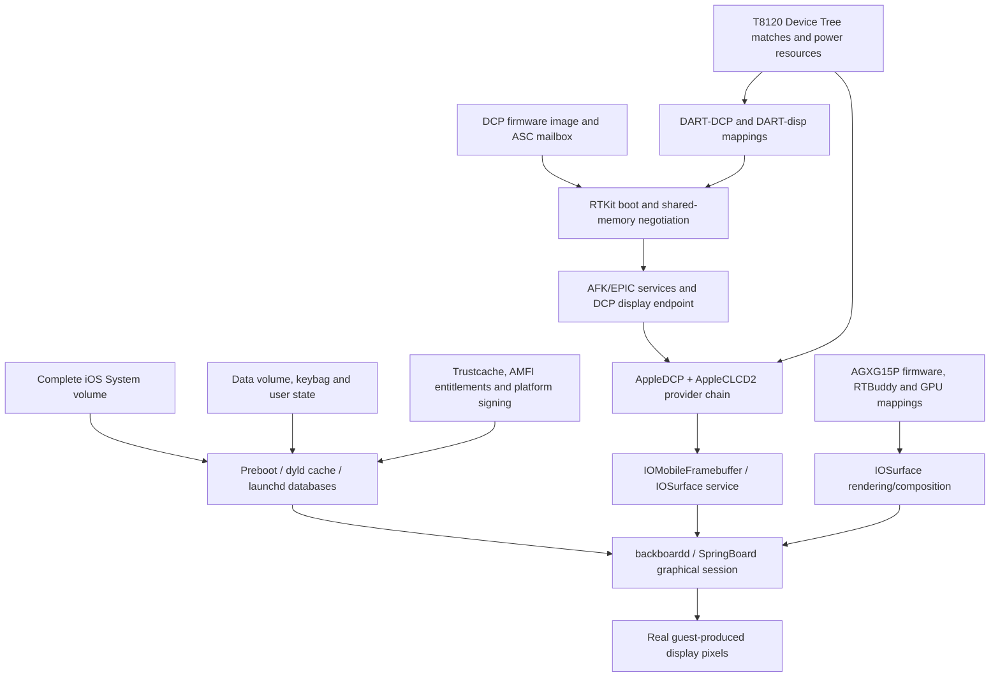

# iOS 26.6 display-stack audit (M3)

## Result

The current D74AP restore environment cannot legitimately start graphical iOS
userspace.  It contains a small subset of display-facing libraries and the Boot
Kernel Collection contains relevant driver personalities, but the active
launchd configuration contains only the OpeniOS Bash service.  SpringBoard,
backboardd, and WindowServer are absent.  No full iOS system volume is present
in the local firmware set.

The shortest defensible path is therefore not to invent T8120 registers.  It is
to obtain a complete, legally available iOS 26.6 boot filesystem set, reproduce
the normal preboot/data-volume and trust relationships, and separately bring up
the DCP ASC/RTKit plus display DART path until the real kernel drivers expose an
IOMobileFramebuffer service.  Graphical userspace comes after those two tracks
converge.

All firmware inspection in this audit was read-only.  No IPSW, APFS image,
trustcache, or known-good Device Tree was changed.

## Inputs and method

- Guest: iOS 26.6 (23G71), `iPhone15,3` / D74AP / T8120.
- QEMU-SPTM: 11.1.0 at pinned revision
  `bad6336fb24211f8c4e8e946c259bd5b12417340`.
- Ramdisk inventory: `7z l -ba` over
  `ramdisk-shell-v5.apfs`; no mount or write was used.
- Boot KC evidence: embedded prelink/personality strings plus existing and new
  serial boot logs.  Presence in the collection is not treated as proof that a
  driver matched or started.
- Device Tree evidence: decoded `dtree.original` and the normal fixed-up
  `dtree`, plus source inspection of `third_party/darwin-vm/dt_fixup.py`.

The locally extracted firmware directory contains a Boot KC, Device Tree,
SPTM, TXM, one approximately 232 MiB restore DMG, restore ramdisks, and
trustcaches.  A search found no `.ipsw` and no full System volume image.  This
is an extracted restore subset, not a complete installed iOS filesystem.

## Restore filesystem audit

The active `System/Library/LaunchDaemons` contains exactly one job:
`com.jprx.bash.plist`.  Its program is `/bin/bash`, it uses the console for
standard I/O, and it is kept alive.  The preserved `LaunchDaemons.old` contains
nine restore/support jobs (driverkitd, syslogd, camera support, diskimagesiod,
PurpleReverseProxy, ReportCrash, and restored_external); none is a graphical
session launcher.

Relevant files that do exist include:

- `System/Library/Frameworks/IOSurface.framework/IOSurface`
- `System/Library/PrivateFrameworks/IOMobileFramebuffer.framework/IOMobileFramebuffer`
- `System/Library/PrivateFrameworks/MiniDisplay.framework/MiniDisplay`
- `/sbin/launchd`

No SpringBoard, backboardd, or WindowServer executable was found in the
ramdisk listing.  Framework presence only makes linking possible; it does not
create the daemon graph, entitlements, preferences, assets, or kernel services
needed to start a graphical session.

The boot log independently reports `Restore environment starting`, failure to
open `/System/Library/xpc/launchd.plist`, no MRM cache, and many skipped or
missing boot-task paths.  It then starts only `com.jprx.bash`.

## Kernel collection and runtime evidence

The Boot KC includes the following relevant personalities or identifiers:

| Component | Static match evidence | Runtime evidence in audited boots |
| --- | --- | --- |
| AppleARMBacklight | IOName `backlight` | Starts; reports no backlight enable or update function |
| AppleDCP / AppleDCPExpert | IOName `dcp-expert-v1`; RTBuddy endpoint personalities | No start message and no selected DCP MMIO |
| AppleMobileDispH15P-DCP / AppleCLCD2 | IOName `disp0,t8120` and `dispext0,t8120`; DCP endpoint 24 link | No start message and no selected disp0 MMIO |
| AGXG15P | IOName `gpu,t8120` | No start message; SGX is deliberately removed by the normal fixup |
| RTBuddy/ASC support | `iop-nub,rtbuddy-v2` identities and endpoint classes | No DCP RTKit handshake evidence |
| IOMobileFramebuffer | Classes and userspace framework are present | No published framebuffer or guest pixel descriptor observed |

The normal Device Tree fixup recursively removes every `compatible` property
which does not contain one of the QEMU-supported driver strings.  It also
removes the `sgx` node explicitly.  Consequently, the normal fixed-up tree
lacks the original display matches:

| Node | Original `compatible` | Normal fixed-up result |
| --- | --- | --- |
| `dcp` | `iop,ascwrap-v6` | removed |
| `dcp/iop-dcp-nub` | `iop-nub,rtbuddy-v2` | removed |
| `dcp0-expert` | `dcp-expert-v1` | removed |
| `disp0` | `disp0,t8120` | removed |
| display DART nodes | `dart,t8110` / `iommu-mapper` | removed |
| `sgx` | `gpu,t8120` | node removed |

This explains why the known-good M1 configuration does not match the display
stack.  It does not imply that restoring strings is sufficient to start it.

## Controlled Device Tree probes

`openios/tools/display/make_display_probe_dtree.py` creates a new output from
the unmodified Apple tree, runs the normal QEMU fixup, and then restores only
explicitly selected compatible groups.  It refuses to overwrite an output and
never restores SGX.  Probe files were written under `/tmp`; the firmware files
retained their original SHA-256 values.

Example:

```sh
python3 openios/tools/display/make_display_probe_dtree.py \
  openios/firmware/linux/iphone15-3-26.6/boot/dtree.original \
  /tmp/openios-m3-disp0-only.dtree \
  --nvram third_party/darwin-vm/nvram.bin \
  --disable-network --enable disp0
```

Results:

| Probe | Boot result | Driver/MMIO evidence |
| --- | --- | --- |
| Normal fixed-up tree | root shell (established M1 baseline) | 0 selected display reads/writes |
| Restore only `disp0,t8120` | root shell; `uname`, `id`, and launchd listing passed | No AppleCLCD2 start evidence; 0 reads/writes |
| Restore DCP ASC, RTBuddy nub, and `dcp-expert-v1` | root shell | No AppleDCP/RTKit start evidence; 0 reads/writes |
| Restore only the three display-DART groups | did not reach serial output or root shell before the 45-second timeout | 0 reads/writes; an early provider/startup wait is likely, but its exact site is not yet proven |

The tracer was already validated by a deliberate monitor access in M2.3a, so
these are operational zero-access results, not a disabled observer.  The
experiments show that compatible strings alone do not satisfy the provider,
power, firmware, endpoint, and mapper dependencies.  No fake MMIO response was
added.  The DART-only result is also why the compatible groups must remain
independently opt-in: enabling every original display match at once is not a
valid regression configuration.

## Real graphics startup dependency graph



This graph distinguishes two necessary tracks.  A complete graphical
userspace cannot compensate for a missing DCP/DART kernel path, and a working
scanout controller cannot launch SpringBoard from this shell-only ramdisk.

## Security and filesystem blockers

A full-system experiment needs, at minimum, the matching sealed System volume,
Preboot contents and kernel collection metadata, dyld shared cache and launchd
configuration, a writable/matching Data volume, keybag and user/session state,
and platform-signed binaries with a compatible trustcache/AMFI policy.  Device
identity, SEP-backed services, preferences, MobileGestalt capabilities, and
service-specific entitlements may become additional blockers.  None should be
worked around by modifying the known-good M1 assets in place.

## Prioritized backlog

1. Acquire or extract the complete matching iOS 26.6 filesystem set without
   changing M1 inputs; inventory its graphical launch graph, dyld dependencies,
   entitlements, and volume roles before attempting to boot it.
2. Add read-only IOKit matching diagnostics (or targeted kernel boot logging)
   to identify the exact provider/resource wait for AppleDCP and AppleCLCD2.
3. Reintroduce compatible groups one at a time on generated DT copies and
   require a new observable (match log, mailbox access, or DART access) before
   proceeding.  Do not enable AGX yet.
4. Implement the minimal evidence-backed DCP ASC mailbox and RTKit shared-memory
   transport, then the required DART mappings; keep it opt-in.
5. Discover the DCP service and complete a no-scanout protocol handshake before
   implementing surface submission.
6. Capture a real guest-created surface address, format, stride, and mapping;
   use the existing guest-RAM console only as a diagnostic viewer.
7. Bring up AGX only after logs show graphical userspace requires GPU services;
   do not infer GPU register semantics from M-series Macs.

## Regression status

The normal M1 tree remains unchanged.  The immediately preceding M2 sprint
build passed with `ninja -j2`; `--disable-werror` remains necessary for the
pre-existing GCC 15 enum-pointer `sscanf` warning in `apple_aic.c`.  This M3
audit changed no QEMU source and required no rebuild.

The normal trace-off M1 boot and the M2 trace-on/test-display-on boot reached
`bash-5.3#`.  In M3, both generated compatible probes also reached the prompt;
the disp0-only run additionally passed `uname`, `id`, and launchd-directory
checks.  The DART-only negative probe timed out before serial output and is not
a passing boot.  All selected display MMIO counters remained zero.

No iOS display output or SpringBoard startup was achieved or claimed.
